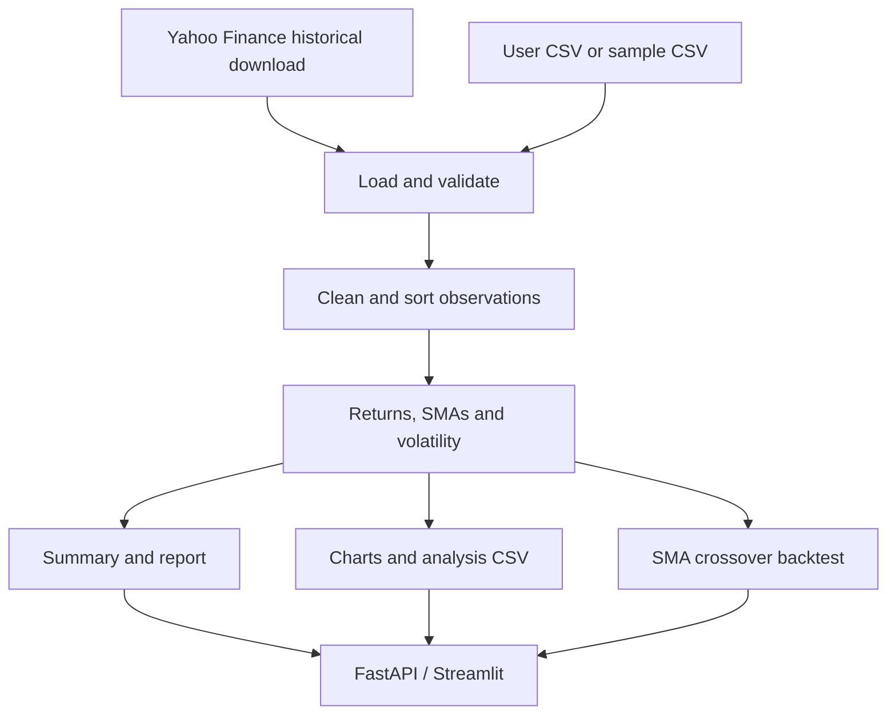

# Stock Market Data Analyzer

An educational Python application for analyzing historical stock prices from Yahoo Finance or a user-provided CSV. It calculates returns, moving averages and historical volatility, creates charts and reports, demonstrates a simple SMA crossover backtest, and exposes the analysis through FastAPI and Streamlit.

> **Educational project only. It is not financial advice, a recommendation, or a trading system. Historical performance does not predict future results. Yahoo Finance downloads are historical snapshots and are not guaranteed to be real time.**

## Problem statement

Historical stock prices arrive as tables that can be hard to interpret quickly. This project turns a selected price series into a reproducible summary of its price range, returns, trend indicators and variability, with charts that are easier to discuss in a classroom demonstration.

## Objectives

- Load public historical prices or a CSV without requiring a paid terminal.
- Clean dates and price values and validate user input.
- Calculate daily percentage returns, SMA 20, SMA 50 and 20-session annualized historical volatility.
- Visualize prices, indicators, returns and available trading volume.
- Compare a simple crossover simulation with buy-and-hold while avoiding look-ahead bias.
- Demonstrate modular Python, a CLI, an HTTP API and an interactive dashboard.

## Features

- Yahoo Finance historical data and explicit CSV input; Yahoo failures are reported, never silently replaced with sample data.
- Cleaning: parsed and sorted dates, invalid or non-positive closing prices removed, duplicate dates reduced to the last row.
- Summary: record count, first/latest/minimum/maximum/average closing prices, period return, moving averages, volatility and a descriptive trend reading.
- Saved closing-price, SMA, daily-return time series, daily-return distribution and optional volume charts.
- `analysis.csv`, `summary.csv` and `summary.txt` output artifacts.
- Backtest signals (`BUY`, `SELL`, `HOLD`), strategy and buy-and-hold returns, and equity curves.
- FastAPI endpoints with Swagger UI and CSV upload.
- Streamlit dashboard with a high-contrast dark theme, Yahoo/CSV selection, date controls, charts, backtest view and download buttons.

## Technologies

Python 3.10+, pandas, NumPy, Matplotlib, yfinance, FastAPI, Uvicorn, python-multipart, Streamlit and the Python standard library.

## Architecture



See [docs/architecture.md](docs/architecture.md) for the component diagram and data flow.

## Folder structure

```text
Stock Market Data Analyzer/
├── data/sample_prices.csv
├── .streamlit/config.toml    # Streamlit dark theme
├── docs/
│   ├── architecture.md
│   ├── project_documentation.md
│   ├── testing_report.md
│   └── PROJECT_GUIDE.md
├── images/                 # Add presentation screenshots here
├── notebooks/              # Optional experiments
├── outputs/                # Generated CSVs, report and PNG charts
├── reports/                # Optional curated report copies
├── src/
│   ├── __init__.py
│   └── stock_analyzer/
│       ├── analyzer.py
│       ├── api.py
│       ├── backtesting.py
│       └── cli.py
├── tests/
│   ├── __init__.py
│   ├── test_core.py
│   └── test_dashboard.py
├── dashboard.py
├── main.py
├── requirements.txt
└── .gitignore
```

## Installation on macOS

From the project root, create and activate a virtual environment:

```bash
python3 -m venv .venv
source .venv/bin/activate
python -m pip install --upgrade pip
python -m pip install -r requirements.txt
```

If using the existing project environment without activating it:

```bash
"$PWD/.venv/bin/python" -m pip install -r requirements.txt
```

## Run the CLI

Use the included, clearly labelled sample data (offline):

```bash
.venv/bin/python main.py --ticker DEMO --csv data/sample_prices.csv
```

Download historical data from Yahoo Finance (internet required; end is exclusive):

```bash
.venv/bin/python main.py --ticker RELIANCE.NS --start 2025-01-01 --end 2025-11-26
```

Use your own CSV with `Date` and `Close` columns. `Open`, `High`, `Low`, and `Volume` are optional. Generated artifacts go to `outputs/` by default. The sample CSV is synthetic demonstration input and is clearly identified as sample data; it is not actual stock history.

## Run the Streamlit dashboard

```bash
.venv/bin/python -m streamlit run dashboard.py
```

Choose Yahoo Finance or CSV in the sidebar, select an inclusive date range, and click **Analyze Stock**. CSV upload requires `Date` and `Close` headers. Use the sidebar to switch among Analysis, Backtesting and About.

## Run the FastAPI backend

```bash
.venv/bin/uvicorn src.stock_analyzer.api:app --reload
```

Open Swagger UI at <http://127.0.0.1:8000/docs>. API date query parameters use ISO format and an **exclusive** end date to match Yahoo Finance.

| Method | Endpoint | Purpose |
|---|---|---|
| GET | `/` | Application and docs information |
| GET | `/health` | Health status |
| GET | `/analyze/{ticker}?start=2025-01-01&end=2025-11-26` | Download and summarize historical data |
| POST | `/analyze/csv?ticker=DEMO` | Multipart CSV upload and analysis |
| GET | `/latest` | Most recent summary in this API process |
| GET | `/backtest/{ticker}?start=2025-01-01&end=2025-11-26` | Historical crossover comparison |

The latest-summary cache is in memory and resets when the API process restarts. CSV upload is limited to 5 MB and does not accept a server-side filesystem path.

## Backtesting explanation

The educational strategy buys/holds long when SMA 20 is above SMA 50, sells to cash when it crosses below, and otherwise holds the prior position. A signal observed at one closing price affects the **next** session's return; the simulator shifts positions by one row to avoid using future information. It compares compounded strategy returns to buy-and-hold over the same observations. Transaction costs, taxes, slippage, dividends and market impact are not included. Past simulated returns do not predict future outcomes and are not a recommendation.

## Sample output

The sample CSV contains 20 synthetic rows. Its close moves from 101.00 to 115.00, approximately 13.86% over that sample period. Treat this only as a demonstration of calculations and chart generation.

## Screenshots

Screenshots of the application dashboard, stock analysis, backtesting results, and API documentation will be added here.

## Limitations

- Yahoo Finance availability, adjustments, symbols and historical records can change; network access is required for downloads.
- This is historical analysis, not a guaranteed real-time feed.
- SMA values on short histories use the observations available so far; they are not full 20/50-session histories until enough sessions exist.
- The crossover simulation is intentionally basic and excludes trading costs and many portfolio constraints.
- No database, authentication, multi-user watchlists, persistent alerts, or Next.js client is included.
- The included sample CSV is synthetic and must not be described as a real security's data.

## Run automated checks

```bash
.venv/bin/python -m unittest discover -s tests -v
```

The tests use the included sample fixture and cover cleaning, indicators, short history, optional volume, report/chart output, invalid inputs, no-fallback Yahoo failures, backtest position timing, and Streamlit source labels, CSV/navigation/download/error flows. See [docs/testing_report.md](docs/testing_report.md) for the most recent Yahoo, API, and dashboard checks.

## Future enhancements

Add unit-tested data adapters, configurable transaction costs, richer risk measures, portfolio/watchlist persistence, alert rules, and an optional Next.js client after the local educational version is validated.

## Financial disclaimer

This project is for coursework and demonstration only. It is not financial advice and does not recommend buying or selling an investment. Historical indicators and backtests are limited descriptions of past data; they do not guarantee future outcomes.

## GitHub preparation

No push is performed automatically. This working folder may not yet be a Git repository. Check with `git status`; if it says this is not a repository, initialize it with `git init`. Review the diff and generated artifacts, then:

```bash
git status
git init
git add README.md docs src tests dashboard.py main.py requirements.txt .gitignore .streamlit data images notebooks reports outputs
git commit -m "Complete stock market analysis project"
git branch -M main
git remote add origin https://github.com/YOUR-USERNAME/stock-market-data-analyzer.git
git push -u origin main
```

`git status` lets you review what will be included; `git add` stages only named project files; `git commit` records the reviewed changes; `git branch` selects the main branch; `git remote add` connects the repository to your own empty GitHub repo; `git push -u origin main` uploads the first commit and sets the upstream. Do not stage `.venv`, secrets, or large downloaded datasets. If an origin already exists, inspect it with `git remote -v` instead of adding it again.
