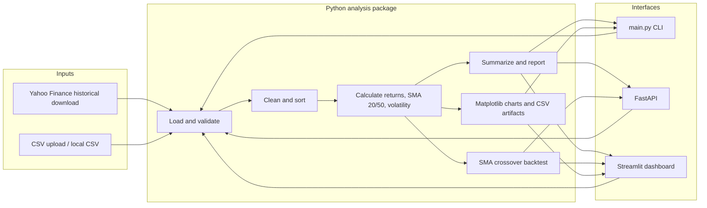
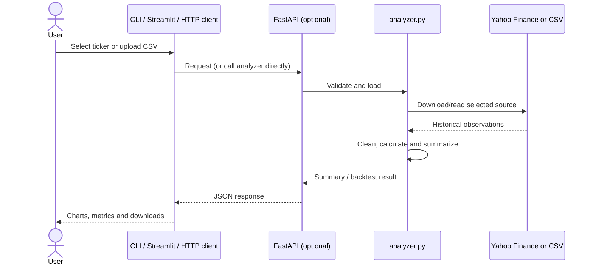

# Architecture and workflow

## Component diagram

## Data flow

1. The CLI, API, or dashboard selects a ticker/date interval or CSV.
2. `analyzer.load_data()` requests Yahoo Finance historical prices or reads the explicitly chosen CSV. Download failures raise an error; the sample is never substituted silently.
3. `clean_data()` normalizes column names, parses dates and numeric fields, requires `Date` and `Close`, removes unusable closing prices, deduplicates dates and sorts observations.
4. `calculate_metrics()` appends daily percent return, SMA 20, SMA 50, and a 20-session annualized rolling standard deviation of daily returns.
5. `summarize()` derives period return, range/average prices, latest averages, full-period and latest 20-session volatility, trend text and observations from those prices.
6. `save_outputs()` writes CSV, summary text, price/SMA/return/distribution charts and a volume chart when valid volume exists.
7. `backtesting.run_sma_backtest()` marks crossover dates and applies the prior session's position to the current session's return.
8. FastAPI returns JSON and accepts CSV uploads; Streamlit displays the same calculations and provides CSV/report downloads.

## API sequence

## Design notes

- Pandas handles time-indexed observations and rolling calculations; NumPy provides annualization with `sqrt(252)` sessions per year.
- The project uses a single analysis package to keep the course version approachable. `backtesting.py` is separate because it has its own signal and position timing logic.
- Generated outputs are local artifacts, not a database. The API `/latest` endpoint is an in-memory process cache and resets on restart.
- Yahoo Finance `end` is exclusive. The dashboard treats the selected end date as inclusive by adding one day before requesting data.
- The workflow uses historical downloads; it does not provide guaranteed real-time streaming.
